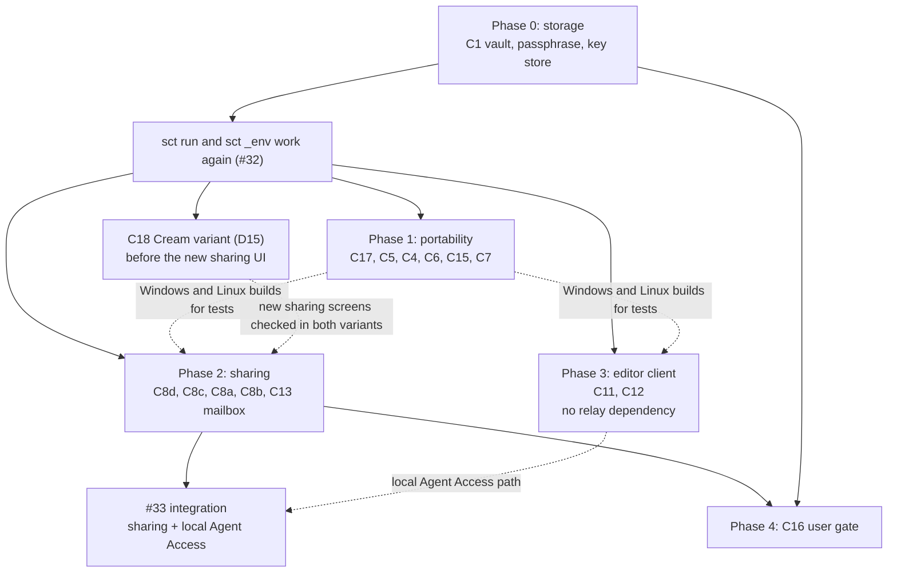

# Implementation plan (Phases 0 to 4)

## 1. Overview

This document is a plan. It changes no code.
The closed decisions are in [docs/fork-plan.md](fork-plan.md). This plan does not open them again.
Every task needs your approval before work starts.

The [remaining feature plan](remaining-features-plan.md) expands tasks 2.5–2.11 and 4.1–4.4.
It records the technical choices selected under the user's delegation, dependencies, and completion checks.
Its detailed specification closes P1–P6, D11, Q9, and Q10. Implementation remains separate from this planning request.

### Goal of the fork

The fork makes `sct` work on macOS, Windows, and Linux.
It replaces the per-value Keychain items with one vault key that a passphrase unlocks.
It adds peer-to-peer sharing and keeps the relay as an optional mailbox.
It adds a VS Code client, a user gate, and a later theme change.
The app is `global.sct`, with identity `app.global-sct.desktop`. It keeps the `sct` CLI and `@sct/env` (updated D5, D19).
Existing storage uses the [explicit fork migration](fork-storage-migration.md).

### Phase names

The fork phases in this document are different from "Phase 2 relay sharing" in [docs/architecture.md](architecture.md).
In this document, "Phase N" always means a fork phase.

### Phases in order

| Phase | Name | Items | Needs first |
|---|---|---|---|
| 0 | Storage | C1, with D1 to D4 and D16 closed | None |
| 1 | Portability | C17, C5, C4, C6, C7, C15 | Phase 0 |
| 2 | Sharing | C8d, C8c, C8a, C8b, C13 | Phase 0 |
| 3 | Editor client | C11, C12 | Phase 0 |
| 4 | Access and looks | C16, C18 | Phase 0 and Phase 2 for C16. All other phases for C18 |

### Dependencies

- Phase 0 comes first. Every later phase reads keys through the new vault.
- Phase 0 replaces the storage under `sct run` and `sct _env` (#32). `sct run` must work again before relay or sharing work starts. This keeps the rule "#32 runtime injection before relay setup".
- After Phase 0, Phase 2 (sharing) and Phase 3 (editor client) are independent branches.
- Phase 3 uses only local paths, such as the CLI and local Agent Access. It must have no direct or indirect relay dependency.
- Phase 1 can run in parallel with Phase 2 and Phase 3. Windows and Linux tests of Phase 2 and Phase 3 need the Phase 1 builds.
- Issue #33 stays the only work that joins sharing and local Agent Access. Its remote demo tasks use the mailbox (relay) after Phase 2. See question Q9.

## 2. Phase 0: storage

### Goal

Replace the per-value Keychain keys with one `scrypt` master key and envelope encryption.
Unlock with a passphrase. "Remember this device" is optional.

### Status (2026-11-04)

| Item | State |
|---|---|
| 0.1 Shared types | Done, `src/shared/vault.ts` |
| 0.2 Header parser | Done with zod in `src/main/vault-header.ts` |
| 0.3 Derive and verify | Done |
| 0.4 Key stores | Done, `src/main/key-store.ts` |
| 0.5 Master key and `SCT2` | Done |
| 0.6 `unlock`, `lock`, `isLocked` | Done |
| 0.7 Grant cleanup under the master key | Done |
| 0.8 Unlock screens | Done, `UnlockView.tsx` |
| 0.9 CLI unlock window | Done |
| 0.10 Timing | Done for the vault and CLI path. The window session is not measured |
| 0.11 Clean break check | Done by hand on Windows |
| 0.12 Docs | Done for storage and runtime injection |
| Q2 Sharing identity and relay token | Done. They are in `.internal/` under the master key |

The design is in [docs/storage-design.md](storage-design.md). This section does not repeat it.
It lists the tasks, the gaps that the design does not cover, and the checks.

### Prerequisites

- Decisions D1, D2, D3, D4, and D16 are closed.
- You answer the five open questions in section 7 of [docs/storage-design.md](storage-design.md).
- You answer questions Q1 to Q4 in section 5 of this document.

### Work items

| Order | Item | Task | Files |
|---|---|---|---|
| 0.1 | C1 | Add the shared types `VaultHeader`, `ScryptParams`, `SealedField`, `WrappedKey`, and `SecretStore`. | New `src/shared/vault.ts` |
| 0.2 | C1 | Add the header parser for `vault.json`. Use an Effect schema with `Schema.UnknownFromJsonString` and `Schema.decodeUnknownOption`. Return a typed error for a parse failure, a bad version, or a bad field length. See Q1. | New `src/main/vault-header.ts` |
| 0.3 | C1 | Add `deriveMasterKey` and `verifyPassphrase`. Use `scrypt` from `node:crypto`. Fill each temporary `Buffer` with zeros after use. | `src/main/vault-header.ts`, `src/main/seal.ts` (no change to the cipher) |
| 0.4 | C1 | Add `KeyringSecretStore`, `PassphraseOnlySecretStore`, and `InMemorySecretStore`. The keyring store uses one `master-key` item under the `global.sct` service. | New `src/main/key-store.ts` |
| 0.5 | C1 | Change `Vault` to use the master key. Wrap one file key for each project and one data key for each value. Change the file magic from `SCT1` to `SCT2`. Remove the per-value `AsyncEntry` reads. Keep the serial queue and the `.tmp` plus `rename` writes. | `src/main/vault.ts` |
| 0.6 | C1 | Add `unlock`, `lock`, and `isLocked` to `Vault`. A locked vault returns an error that asks for an unlock. Accept a `SecretStore` in the constructor. | `src/main/vault.ts` |
| 0.7 | C1 | Move the grant-cleanup key from its Keychain item to the master key. See Q2. | `src/main/vault.ts` |
| 0.8 | C1 | Add the unlock and first-run passphrase screens. Add the "Remember this device" option. Disable the option when `available()` returns `false`, and show the reason. Send no key and no passphrase result back to the renderer. | `src/renderer/src/` (new view), `src/preload/index.ts`, `src/shared/api.ts`, `src/main/index.ts` |
| 0.9 | C1 | Unlock in the CLI paths. `sct run` asks for the passphrase on the terminal. `sct _env` and `sct mcp` have no terminal. For them, see Q3. | `src/main/index.ts`, `src/main/runtime.ts`, `src/main/agent.ts` |
| 0.10 | C1 | Time `sct run -- true` with 10 secrets and with 40 secrets. Measure with "remember this device" on and off. Record the results in [docs/storage-design.md](storage-design.md). Do the measurement by hand. Add no test harness. | Docs only |
| 0.11 | D4, D16 | Confirm the clean break. Put an `SCT1` file and an old transfer file in the vault folder. Make sure that the build ignores them or rejects them with a clear message. Do this check by hand. | Docs only |
| 0.12 | C1 | Change [docs/storage.md](storage.md) and [docs/runtime-injection.md](runtime-injection.md) for the new unlock. | Docs |

The main functions show the success path. The validation goes into small named helpers below them:

```ts
// src/main/vault-header.ts
export async function readVaultHeader(file: string): Promise<VaultHeader> {
  const header = decodeHeader(await readFile(file, 'utf8'))
  if (!header) throw new Error('The vault header is damaged or has an unsupported version.')
  return header
}

function decodeHeader(text: string): VaultHeader | undefined {
  // Schema.UnknownFromJsonString followed by the VaultHeader schema. The result is Option<VaultHeader>.
  return Option.getOrUndefined(Schema.decodeUnknownOption(VaultHeaderFromJson)(text))
}
```

### Key decisions

The closed decisions D1, D2, D3, D4, and D16 control this phase.
Q1 to Q4 are also closed. See section 7 of [docs/storage-design.md](storage-design.md).
The remaining question is the relay cache keys. A Linux system with no secret service cannot use the relay mailbox until those keys move.

### Risks

- **Old tests break.** `tests/vault.test.ts`, and maybe `tests/runtime.test.ts` and `tests/sharing.test.ts`, use the `SCT1` format and per-value keys. Q4 is closed: edit the tests that the format change breaks. Add no new test without approval.
- **Slow `sct run`.** Each process that has no remembered key runs `scrypt` one time. With `N = 2^17` this is 0.3 to 1 second. Task 0.10 measures it. If the time is too long, lower `N` in `vault.json` for new vaults. This needs no format change.
- **Locked vault in the SDK.** `loadEnv` in `@sct/env` starts `sct _env` with no terminal. A locked vault without a remembered key makes `loadEnv` fail. Q3 fixes this. Until then, the error text must tell the user to unlock first.
- **Two processes write together.** The app and `sct run` can both write. Question 5 in the storage design covers this. Do not add a lock file until you name the failure mode.

### Verification

```sh
bun typecheck
bun run check
bun run build:sdk
bun run react-doctor
bun run test:ui
```

`bun run test:ui` runs `bun run build`, which now skips `swiftc` outside macOS. The Playwright suite still expects the pre-unlock layout and uses macOS and POSIX assumptions. It needs an update before it can be a release check.

Phase 0 is done when these conditions are true:

1. All checks pass.
2. A new vault unlocks with a passphrase. A wrong passphrase gives a clear error.
3. "Remember this device" unlocks with no prompt. When no secret service exists, the option is off.
4. `sct run` and `loadEnv` get the correct values.
5. The build rejects or ignores `SCT1` files and old transfer files.
6. The timing results for 10 and 40 secrets are in the docs.

## 3. Phase 1: portability

### Goal

Build, package, and run `sct` on Windows and Linux.
Show macOS-only features only on macOS.
Signed builds wait on D12. Unsigned beta releases are the current path.

### Prerequisites

- Phase 0 is done. On Linux without a secret service, the app needs the passphrase path.
- D12 has an answer before the signing step starts. D13 and D17 are closed.
- Tasks 1.1 to 1.8 do not need D12, D13, or D17.

### Work items

Q5 is closed. C5 and C15 are in Phase 1, as recorded in the implementation status below.

### Status (2026-11-04)

| Item | State |
|---|---|
| 1.1 | Done. The preload bridge sends `platform` as a fixed value. |
| 1.2 | Done. `scripts/build-airdrop.ts` skips the `swiftc` step outside macOS. |
| 1.3 | Done. Outside macOS, the app hides the Cards link, cards route, AirDrop controls, and Send/Receive secrets tabs. Verify devices uses pairing links and files on all platforms. |
| 1.4 | Done. Each platform has a process reader. |
| 1.5 | Done with a limit. macOS uses `codesign`, Windows uses Authenticode plus product metadata, and Linux returns an unverified caller. A certificate thumbprint pin is a follow-up. |
| 1.6 | Partly done. Windows writes `sct.cmd` for terminals. A direct MCP client needs `cmd /c` or the full `sct.exe` path. |
| 1.7 | Done. Windows tries `taskkill /T` first and forces the tree after the grace period. Linux keeps process groups. |
| 1.8 | Done. `package:win` and `package:linux` are added. The Windows package is verified. |
| 1.9 | Partly done. Unsigned beta artifacts and SHA-256 checksums. Signing is deferred. |
| 1.10 | Done for checks and unsigned beta releases on three runners. Stable releases wait on signing. |
| 1.11 | Partly done. `docs/windows-linux.md` is added. The signing detail waits on D12. |
| Q5 | Implemented. C5 and C15 are in Phase 1. |
| Q6 | Implemented. A Linux caller is unverified. |

The Windows checks pass for `bun run typecheck`, `bun run lint`, `bun run typecheck:tsc`, `bun run build:sdk`, `bun run build`, and `bun run package:win`.
The packaged `sct.exe skills` command returns the skill list.
Each internal value has its own file in `.internal/`, so two processes cannot corrupt one file with a read-modify-write race.
`prepareRelayTransfer` reads the sharing identity before it enters the vault queue, so it cannot deadlock.
The Windows caller check hides the PowerShell window, uses UTF-8 output, and has a timeout.
The Windows unit test run passes with 37 tests and 3 skips. The skipped tests cover POSIX signal forwarding, the full restart sequence, and the POSIX SDK fixture. A manual restart check passes on Windows.
The release workflow publishes unsigned beta tags with macOS, Windows, and Linux artifacts plus SHA-256 checksums.
The Windows Playwright smoke test passes. It covers first-run unlock, the hidden Cards controls, the pairing controls, and the pairing code flow. It also found and fixed an unlock bug: the old `window.location.reload()` was blocked by the main-process navigation guard.
The existing Playwright suite now unlocks the vault through `tests/ui.ts`. It still uses macOS and POSIX assumptions. A macOS run is not done here.

| Order | Item | Task | Files |
|---|---|---|---|
| 1.1 | C17 | Add the platform to the preload bridge as a fixed value. Do not send the whole `process` object. | `src/preload/index.ts`, `src/shared/api.ts` |
| 1.2 | C5 | Run `build:airdrop` only on macOS. Move the `swiftc` step into a small TypeScript script that does nothing on other systems. Use it in `dev` and `build`. | `package.json`, new `scripts/build-airdrop.ts` |
| 1.3 | C17 | Hide the **Cards** link and the cards route when the platform is not `darwin`. Hide the AirDrop send path and the AirDrop help text. Keep the main-process guard in `sendToNearbyMac`. Do not show an empty view. | `src/renderer/src/App.tsx`, `src/renderer/src/SharingView.tsx`, `src/renderer/src/CardsView.tsx` |
| 1.4 | C4 | Split `identifyCaller` into one process reader for each platform. Linux reads `/proc/<pid>/stat` and `/proc/<pid>/exe`. Windows reads the parent process through a fixed PowerShell `Get-CimInstance Win32_Process` query, with no user input in the command. | `src/main/caller.ts` |
| 1.5 | C4 | Add the signature check for each platform. On Windows, use `Get-AuthenticodeSignature` and compare the signer. On Linux there is no code signature, so a name match gives an unverified caller. See Q6. | `src/main/caller.ts`, `src/shared/agent.ts` (no type change expected) |
| 1.6 | C6 | Add the Windows CLI shim. Write `sct.cmd` to a user folder, for example `%LOCALAPPDATA%\Programs\global.sct\bin`. Keep the marker check and the "do not overwrite another command" rule. On Linux, use the current POSIX script with the Linux executable path. | `scripts/install-cli.ts` |
| 1.7 | C15 | Stop the command on Windows. Windows has no process groups, so `process.kill(-pid)` fails. Use `taskkill /T /F /PID` to stop the child tree. On Linux, keep the process groups. Find `ps` at `/bin/ps` or `/usr/bin/ps`. | `src/main/launch.ts` |
| 1.8 | C7 | Add `scripts/package-linux.ts` and `scripts/package-windows.ts` with `@electron/packager`. Add `package:linux` and `package:win` scripts. Change the `description` in `package.json`, because it says "for macOS". | `scripts/`, `package.json` |
| 1.9 | C7 | Add the signing step for each platform from D12. Read credentials only from CI secrets. Put no credential in the repository. | `scripts/package-*.ts`, `.github/workflows/release.yml` |
| 1.10 | C7 | Add Windows and Linux runners for checks and releases from D13. | `.github/workflows/checks.yml`, `.github/workflows/release.yml` |
| 1.11 | C7 | Write install and signing docs for Windows and Linux. Keep [docs/macos-signing.md](macos-signing.md) (C14). | `docs/` |

### Key decisions

These decisions need your approval. The recommendation is not final.

| ID | Decision | Options | Recommended | Reason |
|---|---|---|---|---|
| D12 | Signing credentials | Apple membership. A Windows certificate. Azure Trusted Signing. | Deferred. Unsigned beta releases until signing is available | Signing is optional for a standalone open-source fork. It is not free |
| D13 | CI runners and release channel | Three runners, or macOS only. `latest` on each push, or versioned releases. | Closed: three runners. Versioned beta tags until signing | A signed build needs a stable version. Beta tags make the unsigned state explicit |
| D17 | Release target | Closed: standalone fork | This repository | It selects the repository, the runner names, and the release channel |

### Risks

- **Real Claude Code fails the check on Linux.** Now `codesign` does not exist on Linux, so `satisfies` returns `false`. Then `identifyCaller` returns `null`, and Claude Code is rejected as an impostor. Task 1.5 fixes this. The Linux caller is then unverified and needs the extra confirmation.
- **A weaker identity check.** A Linux process name is easy to copy. Do not mark a Linux caller as verified from its name or path alone.
- **The keyring native module.** `@napi-rs/keyring` has a prebuilt binary for each platform. Make sure that the package step copies the correct one.
- **Ctrl+C on Windows.** Windows does not send `SIGINT` to a child in the same way. `sct run` can stop the child, but cannot always let it exit cleanly. Record this limit in the docs.
- **No signing credential.** Without D12, the Windows and Linux builds are unsigned. Do not publish them as signed.

### Verification

```sh
bun typecheck
bun run check
bun run build:sdk
bun run react-doctor
bun run test:ui
```

Run `bun run test:ui` on macOS. The Windows smoke test runs on the Windows check runner.
Phase 1 is done when these conditions are true:

1. All checks pass on each selected runner.
2. On Linux and Windows, no **Cards** link and no AirDrop control shows.
3. On macOS, the Cards view and AirDrop work as before.
4. `sct run -- <command>` starts and stops the child on each platform.
5. `sct agent` from Claude Code gives the correct caller state on each platform.
6. The release workflow makes an unsigned beta package for each platform with SHA-256 checksums. Signed packages wait on D12.

## 4. Phase 2: sharing

### Goal

Send secrets in three delivery modes: Direct, Mailbox, and Link.
Every mode uses one envelope and one receipt contract (C8d).

### Prerequisites

- Phase 0 is done. The transports read keys and import secrets through the new vault.
- D6, D7, and D8 are closed.
- D9, D10, and D18 are closed. The mailbox is the current relay. It returns the receipt on pickup.

### Delivery modes

The delivery modes table in [docs/fork-plan.md](fork-plan.md#delivery-modes) controls this phase:

| Mode | Transport | Default when |
|---|---|---|
| Direct | Hyperswarm (C8a) or WebRTC (C8b) | The peer is online |
| Mailbox | The current SpacetimeDB relay | The peer is offline, and the user permits a server copy |
| Link | sct link `global-sct://import/...` (C8c) | Always available |

### Work items

The order below uses the recommended D6 order: Link, then Hyperswarm, then WebRTC.

| Order | Item | Task | Files |
|---|---|---|---|
| 2.1 | C8d | Define the shared transport and receipt types. Put the mode, the transport name, the transfer ID, the recipient device, and the receipt signature in one file. | New `src/shared/transport.ts`, `src/shared/envelope.ts` |
| 2.2 | C8d | Make the relay receipt fit the contract. Keep the relay wire format. Map the relay receipt to the shared receipt in the main process only. | `src/main/envelope.ts`, `src/main/relay-connection.ts` |
| 2.3 | D8 | Add pairing without the relay. Use the current device card and pairing code (`describeDevice`, `formatCode`). Remove the relay identity from the code for non-relay modes. | `src/main/transfer.ts`, `src/main/sharing.ts` |
| 2.4 | C8c | Add the Link transport. Encrypt to the peer's key. Encode as `global-sct://import/...`. Add an `global-sct://receipt/...` link for the manual receipt. Set a maximum size of 16,384 characters. Use the current envelope (Q7). | New `src/main/transport-link.ts` |
| 2.5 | C8c | Register the `global-sct://` protocol handler in the app. Check every link with a strict schema before import. | `src/main/index.ts`, `scripts/package-*.ts` |
| 2.6 | C8a | Add the Hyperswarm transport in the main process. Derive the topic from the verified pair keys. Send the same envelope. Return the receipt in the same session. | New `src/main/transport-hyperswarm.ts`, `package.json` |
| 2.7 | C8b | Add WebRTC in an isolated hidden window with ciphertext, connection metadata, and session TURN credentials. Use the detailed D7 specification. | New `src/main/transport-webrtc.ts`, hidden-window entry, `electron.vite.config.ts` |
| 2.8 | C13 | Put the relay behind the transport interface as the Mailbox mode. Keep the relay module, the SpacetimeDB database, and the relay code. See Q8. | `src/main/relay-connection.ts`, `src/main/index.ts` |
| 2.9 | All | Add the mode selector to the send screen. Show Direct only when the peer is online. Show Mailbox only when the user permits a server copy. Always show Link. Use the Hallmark Terminal role tokens. | `src/renderer/src/SharingView.tsx`, `src/renderer/src/styles.css` (tokens only), `src/shared/sharing.ts` |
| 2.10 | All | Show the receipt state for each mode in the activity list. Build the UI with the delivery code, so that you can test from two app windows. | `src/renderer/src/SharingView.tsx`, `src/renderer/src/SharingMotion.tsx` |
| 2.11 | All | Change [docs/sharing.md](sharing.md), [docs/relay.md](relay.md), and [docs/architecture.md](architecture.md) for the three modes. | Docs |

### Status (2026-11-05)

| Order | Result |
|---|---|
| 2.1 | Done. `src/shared/transport.ts` has the delivery mode, receipt, and record types. |
| 2.2 | Done. The main process verifies the relay receipt and maps it to `TransferReceipt` with mode `mailbox`. Each sent row carries the shared receipt state. |
| 2.3 | Done. Pairing uses a link, a saved file, or a pasted link. The Windows smoke test covers the flow. macOS and Linux are not run here. |
| 2.4 | Done. Link mode uses `global-sct://import/` and `global-sct://receipt/` links with the current envelope. The link limit is 16,384 characters. A manual receipt link verifies the import. The Link tab and saved records work on all platforms. A two-device check is not done here. |
| 2.5 | Done. The app accepts pairing, import, receipt, and connection links from the OS, validates them, holds one pending link, and fills the matching screen. Windows second-instance routing is verified. Packaged registration and macOS/Linux registration are not run. |
| 2.6 | Partly done. Hyperswarm Direct sends and verifies a receipt between two Windows app instances. The Windows package includes Hyperswarm and its native closure. Linux ARM64 builds and packages on the Oracle server. A packaged CachyOS x64 app paired with Windows, sent and imported a secret, and returned the receipt. The CachyOS x64 unit suite passed all 42 tests. macOS and packaged Direct runtime on macOS are not run. |
| 2.7 | Done on Windows. Signed and sealed offer and answer links, the hidden window, chunked transfer, receipt, manual fallback, SDP checks, and the connection deadline work between two app instances. A 60,000-character secret completed an import and receipt. A local TURN-only session showed **Direct via TURN** and completed a transfer and receipt. A direct WebRTC offer between Windows and CachyOS did not connect without STUN or TURN. Public STUN and cross-network WebRTC remain open. |
| 2.8 | Done. The relay is the Mailbox mode. The send gate, verified relay peers, and explicit server-copy permission guard it. A live Maincloud transfer completed pairing, queue, import, and receipt on Windows. |
| 2.9 | Done. The **Send** tab selects Direct, WebRTC, Link, or Mailbox from the current sessions. Mailbox needs the permission checkbox. |
| 2.10 | Done. Relay, Link, Direct, and WebRTC rows show the receipt state. The live Maincloud Mailbox check showed the received state on the sender. |
| 2.11 | Done. This document, [sharing](sharing.md), [relay](relay.md), and [architecture](architecture.md) record the three modes and the remaining platform checks. |

A possible shape for the shared types. All names are proposals:

```ts
// src/shared/transport.ts
export type DeliveryMode = 'direct' | 'mailbox' | 'link'
export type TransportName = 'hyperswarm' | 'webrtc' | 'relay' | 'link'

// One receipt shape for every mode. The recipient signs it with its device key.
export interface TransferReceipt {
  transferId: string
  recipientDeviceId: string
  mode: DeliveryMode
  receivedAt: number
  signature: string
}

export type ReceiptState =
  | { state: 'pending' }
  | { state: 'received'; receipt: TransferReceipt }
  | { state: 'manual' } // Link mode: the sender waits for a pasted global-sct://receipt link.
  | { state: 'expired' }
```

### Key decisions

These decisions are closed (2026-11-04).

| ID | Decision | Answer | Reason |
|---|---|---|---|
| Q7 | Link encryption | The current X25519 envelope (`sct-relay` v1). No `age` library | No new dependency. The envelope has a sender signature. The receipt contract and its tests exist |
| D6 | Transport order | Link, Hyperswarm, WebRTC | Link has no network dependency and tests the receipt contract first |
| D7 | WebRTC signalling | Manual token exchange with signed and sealed `global-sct://connect` links | It adds no server. The signature binds the DTLS fingerprint to the verified peer |
| D8 | Pairing without the relay | The device card as an `global-sct://pair/v1/<card>` link or a file, with the current pairing code | `transfer.ts` already makes and compares these codes. It works on all platforms |
| — | Envelope identity for Link and Direct | The device ID from `describeDevice(card).id` | It passes the current 64-hex check. The wire format does not change |
| — | Link length limit | 16,384 characters. The app checks the length before it decodes the link. Above the limit, the app offers Mailbox | It is below the Windows command-line limit of 32,767 characters |
| — | Link file fallback | None | Mailbox covers large transfers |
| — | Replay check | Vault transfer ID `envelope:${id}:${digest}` for Link and Direct | One envelope cannot be imported one time by Link and again by Direct |
| — | Trusted peers for Link and Direct | `sharing/peers.json` only | Link and Direct stay free of the relay. The relay pins stay separate |
| — | Hyperswarm topic | `HKDF-SHA256(X25519(local, peer), salt "sct-direct-topic-v1", info = UTC day)`, 32 bytes | Only the two peers can find the topic. The topic changes each day |
| — | Hyperswarm announce | Only while the desktop app is open and unlocked | Nothing announces when the app is closed |
| — | Direct receipt | The session stays open for up to 10 minutes for the import. After that, the receipt waits for the next session, or the user sends a manual receipt link | A receipt is never lost |
| — | STUN and TURN | No STUN by default. An option for public STUN. The user supplies TURN, and its credential goes in the vault `.internal/` folder | No third party sees an IP address without consent. No secret file |
| — | Hidden WebRTC window | Ciphertext, SDP, session controls, ICE addresses, and selected TURN credentials. Separate nonpersistent partition and dedicated IPC checks | Selected under delegated planning. No vault keys or shared secret values cross this boundary |
| Q8 | The relay after the three transports | Keep it as the mailbox | D10 and D18 |
| Q9 | AirDrop and C8d | AirDrop stays outside C8d | macOS reports no delivery, so a receipt is not possible |

### Risks

- **NAT failure.** Hyperswarm cannot always connect through a strict NAT. Show "peer not reachable" and offer Mailbox or Link. Do not retry without limits.
- **Native modules.** Hyperswarm uses native modules. Rebuild them for Electron on each platform from Phase 1.
- **Renderer boundary.** The planned hidden WebRTC window receives session TURN credentials as a narrow exception. It receives no vault keys or shared secret values. Update the architecture when implementing this boundary.
- **Link size.** A URL has a practical length limit. A package can be 8 MiB now. Link mode has a limit of 16,384 characters. A larger transfer uses Mailbox.
- **Link replay.** A pasted link can be imported two times. Use the current duplicate-ID check before import.

### Verification

```sh
bun typecheck
bun run check
bun run build:sdk
bun run react-doctor
bun run test:ui
```

Do the two-window check from [docs/secure-sharing-check.md](secure-sharing-check.md) for each mode.
Phase 2 is done when these conditions are true:

1. All checks pass.
2. Each mode sends one secret to a verified peer, and the receipt state is correct.
3. Direct mode is the default for an online peer. Mailbox is the default for an offline peer when the user permits a server copy.
4. A Link import shows a manual receipt link. The sender accepts the pasted receipt.
5. No mode sends a key or a value to the renderer.
6. Local Agent Access works with the relay off.

## 5. Phase 3: editor client

### Goal

Add a VS Code extension that is a client of the app.
The extension starts commands with project secrets. It never receives a secret value.

### Prerequisites

- Phase 0 is done.
- D14 is closed: CLI only.
- Phase 3 does not need Phase 2. It must have no relay dependency.

### Work items

| Order | Item | Task | Files |
|---|---|---|---|
| 3.1 | C11 | Add the extension package in TypeScript. Add its `tsconfig.json` to `typecheck` and `typecheck:tsc`. | New `packages/vscode/`, `package.json` |
| 3.2 | C11 | Connect to the app through the D14 channel. With the recommended CLI path, start `sct` with fixed arguments, as `@sct/env` starts `sct _env`. | `packages/vscode/src/` |
| 3.3 | C11 | Show the projects and the secret names for the open folder. Get metadata only, through the local Agent Access request path and its approval window. | `packages/vscode/src/`, `src/main/caller.ts` (add the editor as a known caller, if approved) |
| 3.4 | C12 | Add the command "Open terminal with project secrets". It opens a VS Code terminal that runs `sct run --interactive -- <shell>`. Only that terminal gets the secrets. | `packages/vscode/src/` |
| 3.5 | C11 | Write the extension docs. Link them from [docs/agent-access.md](agent-access.md) and [docs/runtime-injection.md](runtime-injection.md). | Docs |

### Status (2026-11-04)

| Order | Result |
|---|---|
| 3.1 | Done. `packages/vscode/` is in `typecheck` and `typecheck:tsc`. |
| 3.2 | Done. The extension starts the shared `sct` executable. |
| 3.3 | Done. The tree view shows names and IDs only. Live VS Code behavior is unverified. |
| 3.4 | Done. The terminal command uses `sct run --interactive -- <shell>`. Live VS Code behavior is unverified. |
| 3.5 | Done. The extension guide is in [docs/vscode.md](vscode.md). It is linked from the Agent Access and runtime injection docs. |
| Caller identity | Done for `code` and `Code.exe`. Windows uses the Authenticode signer and product name. macOS uses the app signature. macOS is not run here. Linux is unverified. |

### Key decisions

These decisions are closed (2026-11-04).

| ID | Decision | Answer | Reason |
|---|---|---|---|
| D14 | Extension link | CLI only (`sct agent` and `sct run`) | It adds no socket or pipe (C3). It uses the current caller check and approval window |
| C12 form | How the terminal gets secrets | `sct run --interactive -- <shell>` for each terminal (Q11) | The extension host never receives a value. Only one terminal gets secrets, not every terminal in the window |
| — | Project list | No new agent operation. The extension starts `sct agent list_secrets --stdin` in the workspace folder | `list_secrets` finds the project from the working folder |
| — | VS Code caller | Verified on macOS and Windows after a signature check. The approval text says "or a program that it started". Linux is unverified | Every process that VS Code starts has VS Code as an ancestor |

### Risks

- **Two approval paths.** A separate approval UI in VS Code makes a second path. Use the app approval window only.
- **The extension host gets values.** `environmentVariableCollection` needs the values in the extension. The recommended C12 form prevents this.
- **Caller identity.** The caller walk now includes `code` and `Code.exe`. macOS and Windows use a signature rule. Linux returns an unverified caller. The macOS helper identifier is not in the list, so the walk uses the main app ancestor.
- **Locked vault.** `sct run` from the terminal needs an unlock. The Q3 answer applies here too.

### Verification

```sh
bun typecheck
bun run check
bun run build:sdk
```

Phase 3 has no React UI in the app, so `bun run react-doctor` and Playwright apply only if a task changes the app window.
Phase 3 is done when these conditions are true:

1. All checks pass, and the extension package type checks.
2. The extension lists the projects and secret names after local approval.
3. The extension terminal runs a command with the project secrets. Other terminals have no secrets.
4. No extension log, state, or message contains a secret value.
5. The extension works with the relay off.

## 6. Phase 4: access and looks

### Goal

Ask the user to confirm before each share (C16).
Change the color theme after the other work (C18).

### Prerequisites

- C16 needs Phase 0 for the passphrase verifier and Phase 2 for the final share paths.
- C18 starts before the new sharing UI (D15). Each later screen gets one check in both variants. Task 4.6 takes the final screenshots after the other phases.
- D11 is closed: use the vault passphrase. Q10 covers app and agent shares, with no reveal feature. D15, Q12, and Q13 are closed.

### Work items

| Order | Item | Task | Files |
|---|---|---|---|
| 4.1 | C16 | Add the gate check in the main process. Check the vault passphrase against the `vault.json` verifier. The renderer sends the passphrase one time and receives only pass or fail. | `src/main/vault.ts` or new `src/main/gate.ts`, `src/shared/api.ts` |
| 4.2 | C16 | Run the gate before each share in every mode, and before each AirDrop send on macOS. | `src/main/sharing.ts`, `src/main/index.ts`, Phase 2 transport files |
| 4.3 | C16 | Add the gate dialog. Use familiar form fields and the Hallmark Terminal tokens. | `src/renderer/src/` |
| 4.4 | C16 | Apply the gate to agent operations that send secrets, including `send_secrets_to`. Keep local metadata and runtime approval unchanged. | `src/main/agent-access.ts` |
| 4.5 | C18 | Change only the role-token values in the token declarations. Add no literal color outside them. | `src/renderer/src/styles.css` |
| 4.6 | C18 | Take screenshots of each screen before and after the change. | Docs |

Status (2026-11-05):

- 4.1 to 4.4 are done in the main process. The gate checks the vault passphrase, holds the operation, and releases it once. Link, Direct, WebRTC, Mailbox, AirDrop, and agent `send_secrets_to` use it.
- 4.5 is done. The new screens use the existing role tokens.
- 4.6 is done on Windows for the Send, WebRTC, connection-link review, Link receipt, share confirmation, and packaged Links registration states in both themes. The macOS and Linux variants remain open.

### Key decisions

These decisions are closed. The remaining feature plan defines the confirmation behavior and new-screen checks.

| ID | Decision | Options | Recommended | Reason |
|---|---|---|---|---|
| D11 | Gate factors | Closed under delegated planning | Vault passphrase only | Reuses the verifier across platforms. No WebAuthn dependency |
| D15 | Color theme | Closed: two variants of the Terminal theme, Terminal (dark) and Cream (light). AGENTS.md changes to allow them. The theme work starts before the new sharing UI | — | Each new screen gets one check in both variants. The setting goes in `userData/preferences.json`, because `Vault.moveTo` overwrites `settings.json`. The values are `light`, `dark`, and `system`. The default is `light` (Cream) (Q12) |

### Risks

- **The gate is not a full protection.** A gate cannot protect a compromised machine. State this in the docs.
- **Gate scope.** Q10 covers shares only, including agent shares. It adds no reveal or copy-value action.
- **Theme scope.** Cream and Terminal are already documented in AGENTS.md. Verify new screens in both variants without changing the palette.
- **Token gaps.** A literal color outside the tokens stays the same after a theme change. Search `styles.css` and the `.tsx` files before the change.

### Verification

```sh
bun typecheck
bun run check
bun run build:sdk
bun run react-doctor
bun run test:ui
```

Phase 4 is done when these conditions are true:

1. All checks pass. `react-doctor` gives the score that you approve (target 100).
2. Each share stops until the user passes the gate. A wrong passphrase stops the share.
3. The renderer receives only pass or fail from the gate.
4. After C18, every color and font comes from a role token. The screenshots are in the docs.

## 7. Cross-phase decision summary

Rows that show "Closed" have an answer. The other rows need your answer before their phase starts.

| ID | Phase | Decision | Options | Recommended |
|---|---|---|---|---|
| Q7 | 2 | Link encryption | `age`. The current envelope | Closed: the current X25519 envelope |
| D6 | 2 | Transport order | Link, Hyperswarm, WebRTC. Another order | Closed: Link, Hyperswarm, WebRTC |
| D7 | 2 | WebRTC signalling | Manual token exchange. Stateless broker | Closed: manual token exchange |
| D8 | 2 | Pairing without the relay | One-time code. QR code. DHT topic | Closed: device card link or file, with the pairing code |
| D11 | 4 | Gate factors | Closed | Vault passphrase only |
| D12 | 1 | Signing credentials | Deferred. Unsigned beta releases | Signing later |
| D13 | 1 | CI runners and release channel | Closed: three runners. Versioned tags | Versioned unsigned beta releases |
| D14 | 3 | Extension link | CLI only. Local endpoint. MCP path | Closed: CLI only |
| C12 | 3 | Terminal form | `sct run -- <shell>`. `environmentVariableCollection` | Closed: `sct run --interactive -- <shell>` (Q11) |
| D15 | 4 | Color theme | Keep Terminal theme. New palette | Closed: Terminal and Cream variants |
| D17 | 1 | Release target | Closed: standalone fork | This repository |

## 8. Sequence and dependencies



Phase 2 and Phase 3 are independent branches after Phase 0.
Phase 1 runs in parallel. Its builds are necessary only for tests on Windows and Linux.

## 9. Open questions

Answer these before the phase starts.
Q1 to Q4 are closed. The decisions are in section 7 of [docs/storage-design.md](storage-design.md).

| ID | Phase | Question |
|---|---|---|
| Q5 | 1 | Closed and implemented: C5 and C15 are in Phase 1. |
| Q6 | 1 | Closed and implemented: Linux callers remain unverified and require the extra confirmation. Platform verification is separate. |
| Q7 | 2 | Closed: the current X25519 envelope. No `age` library. |
| Q8 | 2 | Closed: keep the relay as the mailbox (D10, D18). |
| Q9 | 2 | Closed: AirDrop stays outside C8d. Remote demo tasks and results stay on Mailbox. |
| Q10 | 4 | Closed: confirm app and agent shares with the vault passphrase. Add no reveal action. Exclude receipt acknowledgments. |
| Q11 | 3 | Closed: a `--interactive` flag on `sct run`. It starts no detached child, does no live restart, and forwards no stop signal. |
| Q12 | 4 | Closed: the user selects Light (Cream), Dark (Terminal), or System. System follows the OS light or dark setting. Light (Cream) is the default. |
| Q13 | 4 | Closed: Cream uses the dark forest green from the user's reference (`#216929`). It passes 5.6:1 on cream, so both variants use the same selected-tab style. See [docs/theme.md](theme.md). |
| — | All | D6, D7, D8, D11, D13, D14, and D15 are closed. D12 remains deferred. See the remaining feature specification for implementation choices. |
