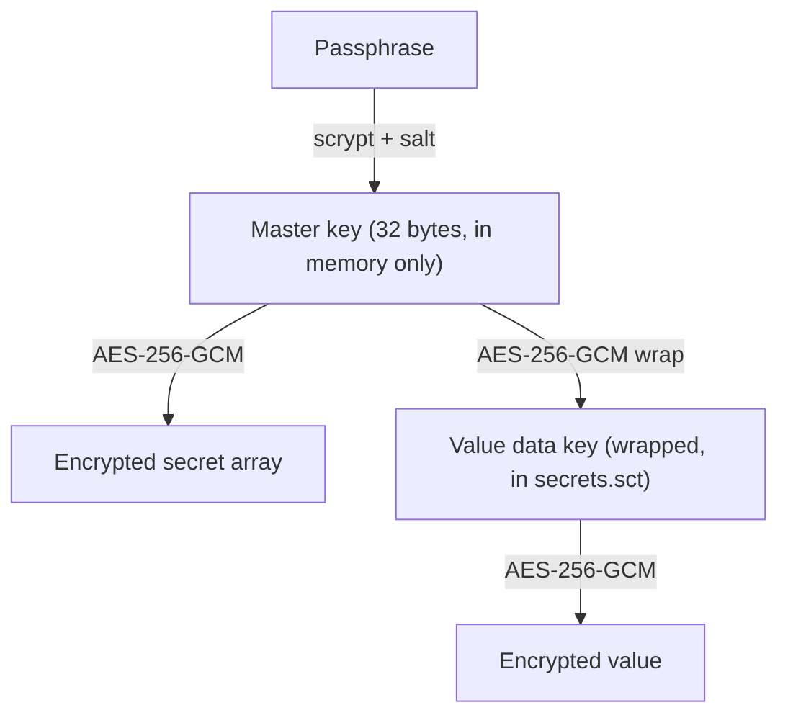
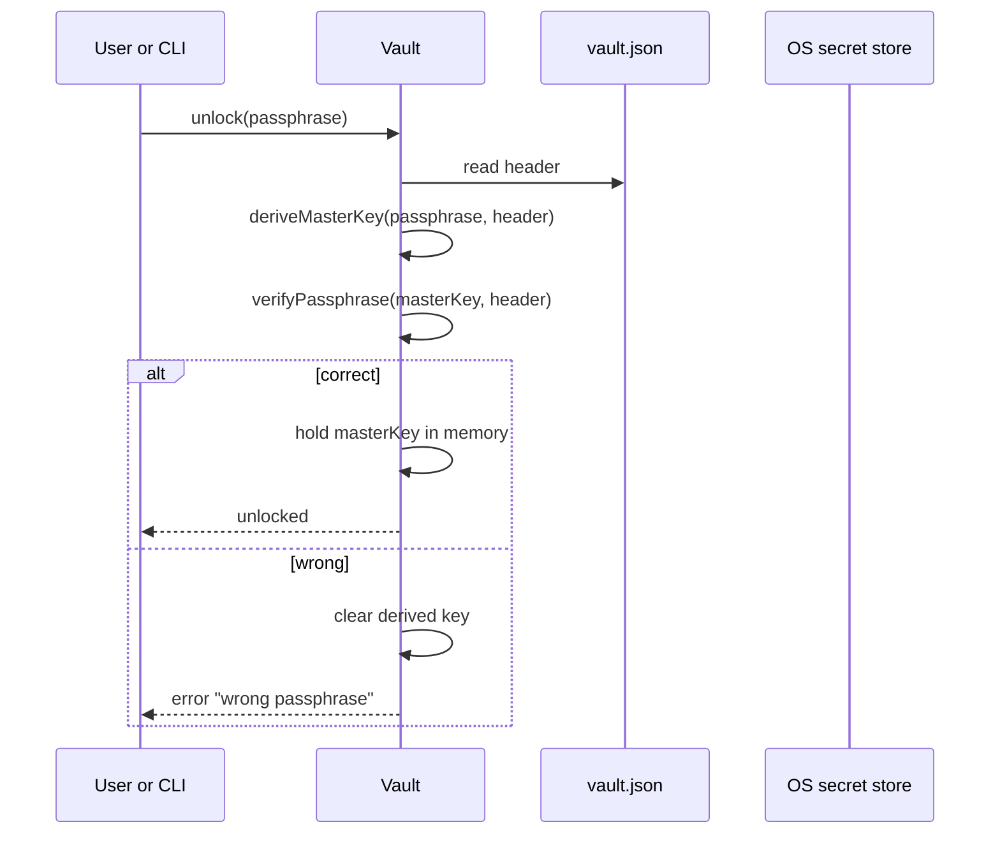
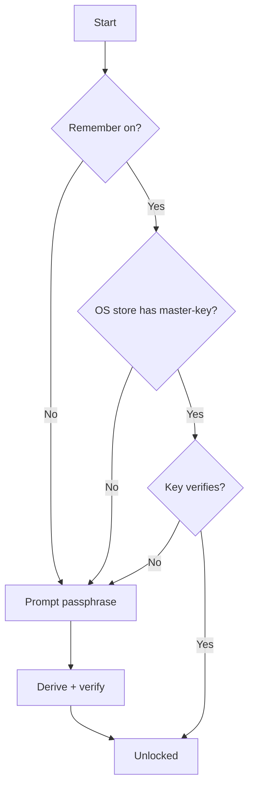

# Storage design (Phase 0)

## 1. Overview and goals

This document designs the new vault storage for `global.sct`.
It covers Phase 0 only. See [docs/fork-plan.md](fork-plan.md) for the decisions.
It does not change any code. It is a design.

### What changes

The current vault keeps one key for each value. See [docs/storage.md](storage.md).
It keeps a file key for each project too.
Every key lives in the OS secret store under the `global.sct` service.
`vault.ts` reads each key with `AsyncEntry` from `@napi-rs/keyring`.
A project read starts one secret-store read for each value.

The new vault keeps one master key for the whole vault (D2).
The user unlocks the master key with a passphrase (D1, D3).
The master key wraps a data key for each value. This is envelope encryption (C1).
The OS secret store holds at most one item, and only as a convenience (D1).

### Why this changes

1. One unlock opens every project (D2). The user enters one passphrase.
2. The key path works outside Electron. The CLI and the MCP server read keys too (C2).
   A passphrase and a file give the same key in every process.
3. Linux without a secret service still works (D1). The passphrase is enough.
4. The OS prompt count drops. The old model reads one item for each value.

### What does not change

1. AES-256-GCM protects every ciphertext. `seal.ts` stays the cipher layer.
2. Additional authenticated data binds each ciphertext to its project and secret.
3. The serial queue in `vault.ts` stays. One operation runs at a time.
4. The app identity stays `app.global-sct.desktop`, and the names stay `sct`, `@sct/env`, and MCP `sct` (D5, D19).

### Clean break

The new build reads no old vault file (D4, D16).
It reads no old transfer file.
It ignores the old secret-store items under the `.sct` service.
The demo data does not move.
The user adds secrets again after the first unlock.
The old sharing identity and relay token are not read. The device gets a new device card and a new relay identity. The user verifies the sharing devices again and pairs the relay devices again.

## 2. On-disk vault file layout

### Location

The vault folder stays `~/global.sct` by default.
`settings.json` in the Electron `userData` folder can move the root. This behavior stays.
On macOS the `userData` folder is usually `~/Library/Application Support/global.sct`.

### Files

| File | Location | Content |
|---|---|---|
| `vault.json` | `~/global.sct/vault.json` | The header. The KDF params, the salt, the verification tag, and the wrapped master key. |
| `secrets.sct` | `~/global.sct/[project-name]/secrets.sct` | The encrypted secrets of one project. |
| `.internal/` | `~/global.sct/internal/` | One sealed file for the sharing identity and each relay token. The master key seals each file. |
| `settings.json` | `userData` folder | The vault root path. No secret. |

The per-project file name and path stay the same as today.
The project name is still the folder name. See [docs/storage.md](storage.md).

### The header file `vault.json`

`vault.json` is one JSON object. It holds no plaintext secret.
It holds the material to derive and verify the master key.

```json
{
  "version": 1,
  "kdf": { "name": "scrypt", "n": 131072, "r": 8, "p": 1, "keyLength": 32 },
  "salt": "<base64, 16 bytes>",
  "verifier": { "iv": "<base64, 12 bytes>", "tag": "<base64, 16 bytes>", "ciphertext": "<base64>" }
}
```

Field meanings:

- `version` is the format version. The current version is `1`.
- `kdf` holds the scrypt parameters. See section 3.
- `salt` is the per-vault scrypt salt. It is random. It is not a secret.
- `verifier` is a sealed constant. It proves the passphrase is correct. See section 3.

The master key does not appear in `vault.json`.
The passphrase derives it each time. The OS secret store can hold a copy. See section 4.

### The per-project file `secrets.sct`

`secrets.sct` keeps the current binary layout from `seal.ts`:
`magic | IV | GCM tag | ciphertext`.
The magic value is `SCT2`. The old value was `SCT1`.
A new magic value makes the clean break explicit. A `SCT1` file fails to decode.

The ciphertext holds a JSON array of stored secrets.
The vault encrypts this array with the master key.
The AAD binds the ciphertext to the project, as today.
The design dropped the project file key. A file key that wraps the array cannot live inside that array.

### The internal folder

`.internal/` holds values that are not project secrets.
It holds the sharing identity and the relay tokens.
Each value has its own file.
The file name is the SHA-256 hash of the value name plus `.sct`.
The file uses the same binary layout as `secrets.sct`: `magic | IV | GCM tag | ciphertext`.
The magic value is `SCI2`.
The ciphertext holds the value bytes.
The AAD is `internal/<name>`.
The file mode is `0600`. Each write uses a unique `.tmp` file and a rename.

The name grammar is `^[a-z][a-z0-9/_-]{0,200}$`.
The names are `sharing/identity` and `relay/token/<sha256-of-server-name>`.
One file for each name prevents a read-modify-write race between the desktop app and an agent session.

### Envelope encryption

The master key does not encrypt secret values directly.
Each value has its own random data key. The master key wraps that data key.
This is envelope encryption (C1).

The flow is two layers:



Each stored secret holds its own wrapped data key.
The master key never touches the disk in plaintext.

A proposed `StoredSecret` shape, with the wrapped data key added:

```ts
interface StoredSecret {
  id: string
  name: string
  // The value data key, wrapped by the master key.
  wrappedKey: WrappedKey
  // The value, sealed by the value data key.
  value: SealedField
  transferId?: string
  grant?: RelayGrant
}

interface WrappedKey {
  iv: string
  tag: string
  ciphertext: string
}

interface SealedField {
  iv: string
  tag: string
  ciphertext: string
}
```

The array and the wrapped value keys live in one file. The write is atomic.
The design adds a small project header inside the encrypted array, or a sibling field.
The exact placement is an open question. See section 7.

### AAD binding

The AAD stays as today. It binds a ciphertext to its owner.

| Ciphertext | AAD |
|---|---|
| The verifier in `vault.json` | `vault-verifier` |
| A wrapped value data key | `${project.id}/${secret.id}/data-key` |
| The encrypted secret array | `${project.id}/file` |
| An encrypted value | `${project.id}/${secret.id}` |

A copied file or a copied field fails to open, because the AAD does not match.

### Version and corruption rejection

The vault rejects a bad header before any decryption.

1. `vault.json` must parse as JSON. A parse failure is a corrupt vault.
2. `version` must equal `1`. Another number is a version mismatch.
3. `kdf.name` must equal `scrypt`. `salt`, `verifier.iv`, `verifier.tag`, and `verifier.ciphertext` must decode from base64 to the correct lengths.
4. A `secrets.sct` file must start with the `SCT2` magic. A `SCT1` file or a short file fails `decodeFile`.

Use the zod schema in `src/main/vault-header.ts` to parse `vault.json`. The project already uses zod.
Parse the JSON, then check it against the schema. A decode failure gives a typed error, not a thrown value.

## 3. Scrypt parameters and the unlock flow

### Scrypt parameters

The KDF is `scrypt` from `node:crypto` (D3). No new dependency.

| Parameter | Value | Reason |
|---|---|---|
| `N` (cost) | `131072` (`2^17`) | A strong interactive cost. It runs in about 0.3 to 1 second on a normal laptop. |
| `r` (block size) | `8` | The standard value. It sets the memory per thread. |
| `p` (parallelism) | `1` | One unlock at a time. More threads give no benefit here. |
| salt length | `16` bytes | A random salt for each vault. It stops precomputed tables. |
| derived key length | `32` bytes | AES-256 needs a 256-bit key. |
| `maxmem` | at least `256 MiB` | `N * r * 128` is about 134 MiB. Node needs headroom above this. |

Node needs `maxmem` above `128 * N * r` bytes.
With `N = 131072` and `r = 8`, that is about 134 MiB.
Set `maxmem` to `256 * 1024 * 1024` to leave headroom.

The exact cost target is an open question. See section 7.
The parameters live in `vault.json`. A future vault can raise the cost without a format change.

### Measured cost

On 2026-11-04, a Windows test machine with Bun 1.4.4 ran the vault and CLI path.
The test used 10 secrets and 40 secrets.
The child command was `bun -e 0`.

| Secrets | "Remember this device" | Median time |
|---|---|---|
| 10 | Off | 227 ms |
| 10 | On | 16 ms |
| 40 | Off | 221 ms |
| 40 | On | 16 ms |

The measurement includes the unlock and the child start. It does not include Electron startup.
The "on" case used an in-memory store, so a read from an OS secret store can add time.
The result stays below the 1 second target at `N = 2^17`.

### Deriving the master key

The main function shows the success path. Helpers sit below it.

```ts
import { scrypt as scryptCallback, timingSafeEqual } from 'node:crypto'
import { promisify } from 'node:util'

const scrypt = promisify(scryptCallback)

async function deriveMasterKey(passphrase: string, header: VaultHeader): Promise<Buffer> {
  const { n, r, p, keyLength } = header.kdf
  return (await scrypt(Buffer.from(passphrase, 'utf8'), Buffer.from(header.salt, 'base64'), keyLength, {
    N: n, r, p, maxmem: 256 * 1024 * 1024
  })) as Buffer
}
```

### Verifying the passphrase

The vault stores a verifier in `vault.json`.
The verifier is a known constant, sealed with the master key and the `vault-verifier` AAD.
A correct passphrase opens the verifier. A wrong passphrase fails the GCM tag check.

```ts
const verifierPlaintext = Buffer.from('sct-vault-v1')

function verifyPassphrase(masterKey: Buffer, header: VaultHeader): boolean {
  try {
    const opened = open(masterKey, decodeVerifier(header.verifier), Buffer.from('vault-verifier'))
    try {
      return opened.length === verifierPlaintext.length && timingSafeEqual(opened, verifierPlaintext)
    } finally {
      opened.fill(0)
    }
  } catch {
    return false
  }
}
```

The GCM tag already rejects a wrong key.
The constant check adds a clear, named success signal.

### The unlock flow



Steps:

1. The vault reads and validates `vault.json`.
2. The vault derives the master key from the passphrase and the salt.
3. The vault verifies the passphrase against the verifier.
4. A correct passphrase keeps the master key in memory. A wrong one clears it and returns an error.

### First run

The vault has no `vault.json` on the first run.
The vault asks the user for a new passphrase.
It generates a random salt.
It derives the master key.
It seals the verifier and writes `vault.json` with version `1`.

### In-memory lifetime of the master key

1. The master key lives in one `Buffer` in the main process after unlock.
2. The master key never reaches the renderer. The renderer never receives a key or a value.
3. On lock, the vault fills the master key `Buffer` with zeros and drops the reference.
4. The CLI holds the master key only for the life of the `sct run` or `sct _env` process. See section 6 for concurrent reads.
5. A derived copy inside a helper is filled with zeros after use, as `vault.ts` does today.

The design cannot clear copies that a string makes.
JavaScript strings are immutable, and the engine can keep copies.
This is a known limit. See [docs/storage.md](storage.md).

## 4. The "remember this device" wrapper

### Goal

The passphrase is the base unlock. It always works (D1).
"Remember this device" is an optional convenience on top of the passphrase.
It is not a replacement for the passphrase.

### How it works

When the user turns on "remember this device", the vault stores the master key in the OS secret store.
It uses `@napi-rs/keyring`. That package uses Windows Credential Manager, Linux libsecret, or macOS Keychain.
The vault stores one item. The account name is `master-key`. The service is `global.sct`.

On a later start, the vault reads the stored master key.
It verifies the key against the verifier in `vault.json`.
A correct key unlocks the vault with no passphrase prompt.
A missing or wrong stored key falls back to the passphrase prompt.



### Graceful fallback with no secret service

Linux often has no secret service. The vault must still work.

1. The vault checks for a secret store at startup.
2. A read or write error from `@napi-rs/keyring` means no usable store.
3. The vault then offers the passphrase only. "Remember this device" is off and disabled.
4. The vault reports the reason in plain language. It does not fail the unlock.

The absence of a secret service never blocks the passphrase path.
The passphrase path needs only `vault.json` and the entered passphrase.

### What the wrapper stores

The design stores the derived master key directly, under one OS secret-store item.
An alternative stores a separate wrapping key and keeps a second wrapped master key in `vault.json`.
The direct form is simpler and needs no extra field.
The choice is an open question. See section 7.

## 5. The SecretStore key-store interface

### One interface

The key store becomes one interface with one option for each platform (C1).
Keep the types in a shared file. Name it `src/shared/vault.ts`.
This file joins the existing shared files such as `src/shared/secrets.ts`.

```ts
// src/shared/vault.ts

export interface VaultHeader {
  version: 1
  kdf: ScryptParams
  salt: string
  verifier: SealedField
}

export interface ScryptParams {
  name: 'scrypt'
  n: number
  r: number
  p: number
  keyLength: number
}

export interface SealedField {
  iv: string
  tag: string
  ciphertext: string
}

// The optional "remember this device" store. It holds at most one master key.
export interface SecretStore {
  // Returns the stored master key, or null when none is stored or no store exists.
  read(): Promise<Buffer | null>
  // Stores the master key. Fails when no store exists.
  write(key: Buffer): Promise<void>
  // Removes the stored master key. A missing key is not an error.
  clear(): Promise<void>
  // Reports whether a usable OS secret service exists on this system.
  available(): Promise<boolean>
}
```

The interface uses `Buffer` and `null`. It never uses `any`.

### The three implementations

| Implementation | Backing | Responsibility |
|---|---|---|
| `KeyringSecretStore` | `@napi-rs/keyring` `AsyncEntry` | The real store. It reads, writes, and clears the `master-key` item under the `global.sct` service. `available` tries a safe read and reports success or failure. |
| `PassphraseOnlySecretStore` | None | For systems with no secret service. `read` returns `null`. `write` and `clear` do nothing. `available` returns `false`. The vault then always prompts for the passphrase. |
| `InMemorySecretStore` | A field in the object | For tests. It holds one optional `Buffer`. It avoids `globalThis`. It needs no OS access. |

The vault selects `KeyringSecretStore` when a secret service exists.
It selects `PassphraseOnlySecretStore` when none exists.
Tests pass `InMemorySecretStore` to the vault constructor.

The master key derivation, the verifier, and the envelope wrapping do not depend on the `SecretStore`.
The passphrase path works with any of the three.
The `SecretStore` only adds the optional skip of the passphrase prompt.

## 6. Failure cases

| Case | Detection | Behavior |
|---|---|---|
| Wrong passphrase | The verifier fails to open, or the opened constant does not match. | The vault returns a clear error. It does not unlock. It clears the derived key. The user tries again. |
| Missing OS secret store | A `read` or `available` call on `@napi-rs/keyring` fails, or the platform has no service. | The vault uses `PassphraseOnlySecretStore`. It disables "remember this device". The passphrase path still works. |
| Corrupt vault file | `vault.json` fails the schema decode, or `secrets.sct` fails `decodeFile`, or a GCM tag check fails. | The vault returns a clear error and does not change the file. It reports which file is affected. |
| Version mismatch | `version` in `vault.json` is not `1`. | The vault refuses to open the vault. It reports the version it supports. It does not guess or migrate. |
| Locked vault | A vault operation runs before an unlock. The master key is not in memory. | The vault returns an error that asks for an unlock first. The CLI prompts for the passphrase. |
| Concurrent access | The serial queue in `vault.ts` already orders operations in one process. Two processes can open the vault at the same time, for example the app and `sct run`. | Each process derives the master key on its own from the same passphrase or the same stored key. Reads are safe. For writes, the vault keeps the current write pattern: write a `.tmp` file, then `rename` over the target. This gives an atomic replace on one disk. Cross-process write ordering is an open question. See section 7. |

Notes:

1. The serial queue stays. `vault.ts` runs one operation at a time inside one process.
2. A GCM tag failure covers a wrong key and a tampered ciphertext together. The vault reports a clear, non-technical message, as `vault.ts` does today.
3. The CLI and the app are separate processes. The serial queue does not cross processes. The atomic `rename` keeps each file consistent.

## 7. Decisions and remaining questions

Decisions taken on 2026-11-04:

| Question | Decision |
|---|---|
| Parser | zod. It is already a dependency. |
| Sharing identity, relay token, grant-cleanup key | Moved under the master key. The sharing identity and the relay token are in `.internal/`. The grant-cleanup data is in `grant-cleanup.sct`. |
| CLI unlock | Ask the signed executable for one window. |
| Existing tests | Edit the tests that the format change breaks. |
| Project file key | Drop it. The master key seals the array. |
| Master key form | Store the master key directly in "Remember this device". |
| Scrypt cost | `N = 2^17`, `r = 8`, `p = 1`, about one second on a current laptop. |

Remaining questions:

1. **Lockout and retry policy.** The vault has no retry limit or delay. Scrypt slows each attempt. Name the threat before adding a lockout.
2. **Cross-process write ordering.** The app and the CLI can both write. The `.tmp` plus `rename` write is atomic on one disk. Confirm that this is enough, or name the failure that needs a lock file.
3. **Relay cache keys.** The relay keeps its per-server cache keys in the OS store. A Linux system with no secret service cannot use the relay mailbox until these keys move. Direct and link sharing do not need the relay cache keys.
